# Praxis Chess website: mobile design brief

**For:** a design review of the **mobile layout only** (viewports 760px wide and below).
**Out of scope:** the desktop layout. It is a separate build and must not change.
**Captured:** 9 October 2026, from the working copy, in mobile Chrome at 390×844 (also 360×780, 375×667 and 430×932).
**Screenshots:** everything referenced below is in [`img/`](img/). The live site at <https://praxis-chess.github.io/> may lag this working copy; treat the screenshots here as the reference.

---

## TL;DR

- One long single-column page: **11 sections, 5,512px tall, 6.5 screens, 452 words** at 390×844.
- Dark, typographic, "instrument panel" identity: near-black warm canvas, one accent colour (orchid `#E7A6D6`), uppercase display headlines, small monospace labels, hairline rules, 4px corners.
- The product is a **desktop app that runs from source**. It cannot be used on a phone, yet every primary button on mobile says "Get Praxis". This is the biggest open question (Q1).
- The items most worth your attention are in [section 10, Known issues and open questions](#10-known-issues-and-open-questions). If you are short on time, start there and use sections 4 to 7 as reference.

**What would help most from you:**
1. A prioritised list of recommendations (what to change first and why).
2. Where useful, an annotated screenshot or a Figma frame at 390×844.
3. Copy changes as before/after pairs.
4. A view on what to **remove or merge**. The owner has asked twice for the mobile page to be shorter and lighter on text.

---

## Contents

1. [The product and the site's job](#1-the-product-and-the-sites-job)
2. [Scope and constraints](#2-scope-and-constraints)
3. [The story: section order](#3-the-story-section-order)
4. [Design system as it applies on mobile](#4-design-system-as-it-applies-on-mobile)
5. [Global chrome: header and menu](#5-global-chrome-header-and-menu)
6. [Component inventory](#6-component-inventory)
7. [Section by section](#7-section-by-section)
8. [Measurements](#8-measurements)
9. [Decisions already made](#9-decisions-already-made)
10. [Known issues and open questions](#10-known-issues-and-open-questions)
11. [Implementation notes](#11-implementation-notes)
12. [Screenshot index](#12-screenshot-index)

---

## 1. The product and the site's job

**Praxis Chess** is a free, open-source (MIT), local-first tool for chess improvement. It pulls a player's games from Chess.com, evaluates every position with the Stockfish engine, finds the mistakes the player **keeps repeating across all their games**, explains them in plain language with a local language model, and turns them into drills built from the player's own positions.

Everything runs on the user's own computer (a Java backend, Stockfish, local models through Ollama, PostgreSQL in Docker, a React interface). **There is no installer yet: it runs from source.** No account is needed, only a Chess.com username.

**Who it is for:** online and club players who want to improve. For now they also need to be comfortable running software from source. The site must still make sense to someone who barely knows chess notation.

**The site's single idea:** *"The engine finds the move. Praxis finds the pattern."* An engine tells you one move was wrong; Praxis counts how often you make the same kind of mistake and tells you why.

**What the site has to do:**
1. Make that idea land in the first screen.
2. Prove it: real screens, the evidence model, research numbers.
3. Send the reader to the source code and setup guide.

On a phone, step 3 is the problem. See Q1.

---

## 2. Scope and constraints

### Breakpoints

| Range | What applies |
|---|---|
| 1081px and up | Desktop build. Out of scope. |
| 761px to 1080px | Tablet adjustments to the desktop build. Out of scope. |
| **760px and below** | **The phone build.** Native scrolling, one column. This brief. |
| **400px and below** | Small-phone tier inside the phone build: gutter 16px (otherwise 20px), the "PRAXIS" wordmark is hidden next to the logo, display type sizes change. **Note that 375px and 390px phones (most iPhones) fall in this tier.** |

Crossing 760px reloads the page, because the desktop and phone builds are genuinely different runtimes: desktop is a fixed-viewport, scroll-driven "scene" experience with pinned, animated compositions; mobile is a normal document. That separation is good news for you: **the mobile layout can be redesigned freely without any risk to desktop**, as long as changes live in the mobile stylesheet or mobile-only markup (see section 11).

### Other constraints

- Static site: hand-written HTML, CSS and JavaScript, no framework and no build step. Hosted on GitHub Pages.
- Dark theme only. There is no light mode and none is planned.
- Webfonts: Inter Tight and JetBrains Mono, from Google Fonts.
- Anything you recommend has to be buildable in plain CSS. Nothing exotic is needed; just worth knowing there is no component library.

---

## 3. The story: section order

The mobile page tells the same story as desktop, condensed. Section numbers in the second column are the ones the site itself prints in small section labels; sections without a printed label are marked "(none)".

| # | Printed label | Section | Its job | Height at 390×844 | Visible words |
|---|---|---|---|---|---|
| 1 | (none) | **Hero** | The idea, in one screen | 812px (0.96 screens) | 40 |
| 2 | 02 / The gap | **The problem** | One mistake, then the pattern behind it | 574px | 55 |
| 3 | (none) | **The difference** | "An engine tells you that you were wrong. Rarely why." | 173px | 18 |
| 4 | 04 / Six stages | **How it works** | The pipeline, as six named stages | 504px | 41 |
| 5 | (none) | **The report** | What you get: the mistake list, ranked | 458px | 17 |
| 6 | 06 / Evidence | **Evidence** | Why the explanations can be trusted | 487px | 71 |
| 7 | 07 / Analysis becomes practice | **Practice** | From weakness to drill | 548px | 14 |
| 8 | 08 / Where it runs | **Local** | Privacy: it runs on your machine | 496px | 56 |
| 9 | 09 / Research | **Research** | The 2B-model study and its numbers | 578px | 72 |
| 10 | 10 / Run it | **Get it** | Source, setup guide, models | 401px | 37 |
| 11 | (none) | **End** | Closing line, final buttons, footer | 481px | 31 |

Full page at a glance: [`img/01-full-page-390.png`](img/01-full-page-390.png)

---

## 4. Design system as it applies on mobile

The website copies the **application's own design tokens**. The stylesheet that holds them states they "must not become original work": the site should look like the product, not like a marketing interpretation of it. Please treat the palette and type families as fixed; how they are *used* on mobile is fully open.

### 4.1 Colour

| Token | Value | Role | Contrast on canvas |
|---|---|---|---|
| `--canvas` | `#121110` | Page background (warm near-black) | |
| `--canvas-deep` | `#0C0B0A` | Header, menu | |
| `--surface-1` | white at 3.5% | Card fill (the boxed captures in Practice) | |
| `--hairline` | white at 8% | Every divider and border | |
| `--text-primary` | `#F2EDEA` | Headlines, list titles, metric values | 16.2:1 |
| `--text-secondary` | `#A29B96` | Body copy, notes, table values | 6.9:1 |
| `--text-tertiary` | `#6D6662` | Section labels, metric labels, micro labels, footer, the dim half of the hero headline | **3.35:1 (fails AA for normal text)** |
| `--orchid` | `#E7A6D6` | The one accent | 9.7:1 |
| `--loss` | `#E2664A` | "Blunder" severity | 5.6:1 |
| `--gain` / `--warn` | `#B9D96C` / `#E5B04B` | Severity scale (inside screenshots) | 11.9:1 / 9.6:1 |
| Hero board | `#342F2D` / `#1E1B1A` | The hero's dark chessboard | squares 1.30:1 to each other |

**How orchid is used, and why it matters:** orchid is a *signal*, not decoration. It marks the primary button, **one word or phrase per headline**, list indices, the key metric in a group, and the one marked square on the hero board. Ambient pink (glows, washes, gradients) was tried twice during development and removed at the owner's request. Please keep that rule in mind when recommending emphasis.

There are no shadows, no gradients and no images used decoratively. Depth comes from hairlines and the 3.5% surface fill only. A 3% film-grain texture sits over the whole page.

### 4.2 Typography

Two families: **Inter Tight** (display and reading) and **JetBrains Mono** (labels, numbers, readouts, the header button). Display headlines are **uppercase with very tight leading** (about 0.87 to 0.95), which is the most distinctive and also the most debatable typographic choice on mobile.

Resolved values at **390px** wide:

| Role | Family | Size / line height | Weight | Tracking | Case | Colour |
|---|---|---|---|---|---|---|
| Section headline, large (`.t-mega`): "On your machine." | Inter Tight | 40 / 34.8 | 600 | −0.045em | UPPER | primary |
| Section headline (`.t-big`): "You just lost a piece." | Inter Tight | 30.4 / 28.9 | 600 | −0.035em | UPPER | primary |
| **Hero headline**: "Praxis finds the pattern." | Inter Tight | **35.2** / 30.6 | 600 | −0.045em | UPPER | primary |
| **Hero setup line**: "The engine finds the move." | Inter Tight | **24** / 22.8 | 600 | −0.035em | UPPER | tertiary (dim) |
| Body (`.t-read`) | Inter Tight | 16.3 / 25.3 | 400 | 0 | sentence | secondary |
| Small body (`.t-note`) | Inter Tight | 13 / 20.2 | 400 | 0 | sentence | secondary |
| List item title (stages, link rows) | Inter Tight | 15.2 to 16.8 | 600 | slightly negative | sentence | primary |
| In-page buttons | Inter Tight | 13.1 | 600 | 0 | sentence | dark on orchid / secondary outlined |
| Metric value | JetBrains Mono | 25.6 | 700 | −0.04em | | primary, key one orchid |
| Engine readout ("Nxd5  eval +0.1 → −2.3") | JetBrains Mono | 13 | 400 / 700 | 0.02em | | primary, "blunder" in red |
| Micro label ("FREE", "OPEN SOURCE, MIT") | JetBrains Mono | 10 | 400 | 0.14em | UPPER | tertiary |
| Table key ("SEVERITY", "ENGINE") | JetBrains Mono | 10 | 400 | 0.14em | UPPER | primary |
| **Section label** ("02 / THE GAP") | JetBrains Mono | **9** | 400 | 0.14em | UPPER | tertiary |
| **Metric label** ("GAMES READ") | JetBrains Mono | **9** | 400 | 0.14em | UPPER | tertiary |
| **Link affordance** ("GITHUB →") | JetBrains Mono | **9** | 400 | 0.14em | UPPER | secondary |
| **Footer** | JetBrains Mono | **9** | 400 | 0.14em | UPPER | tertiary |
| Header button "GET PRAXIS" | JetBrains Mono | 12.5 | 700 | 0.14em | UPPER | dark on orchid |

How the display sizes move across common phones:

| | 360×780 | 390×844 | 430×932 |
|---|---|---|---|
| Hero headline | 32px | 35.2px | 35.2px |
| Hero setup line | 22.4px | 24px | 24px |
| Section headline, large | 40px | 40px | 41.3px |
| Section headline | 28.8px | 30.4px | **29.7px** |
| Metric value | 25.6px | 25.6px | 27.2px |

Two things to notice: the **hero's headline is smaller than every other section's headline** (Q2), and the regular section headline is **smaller on a 430px phone than on a 390px one**, because 390 sits in the small-phone tier with its own scale (Q14).

### 4.3 Spacing and layout

- Spacing scale: 4, 8, 12, 16, 24, 32, 48, 64, 96px.
- Side gutter: **16px** at 400px and below, **20px** from 401 to 760px.
- One column, left-aligned throughout. The only centred element is the hero board and its caption.
- Sections are separated by a **1px hairline plus 24px of padding** above and below.
- The hero's top padding is the 52px header plus 48px.
- **On short phones the spacing shrinks automatically.** Height-based rules written for the desktop build also apply here: at 820px tall or less the 24px step becomes 20px, and at 700px or less it becomes 16px (so section padding is 16px on a 375×667 iPhone SE/8). This was not designed for mobile; it leaks in (Q13).

### 4.4 Shape

Corners are deliberately sharp, because the app is sharp and that is much of why it reads as an instrument: **4px** on cards, **3px** on buttons, **2px** on badges. Borders are 1px hairlines. Rounder shapes would make it look like a different product.

### 4.5 Motion

- **Hero board:** a looping reel of seven tactics on a dark 8×8 board: fork, hanging piece, skewer, pin, back-rank mate, discovered check, removing the defender. Each clip (about 5 seconds) shows a mistake, the move that punishes it, and the motif's shape locking in as orchid wires, nodes and corner brackets. A two-line caption names the motif ("FORK · ONE MOVE, TWO TARGETS") and builds the moves as they are played; seven small ticks between the board and the caption show where the reel is. It pauses when off screen or when the tab is hidden. With "reduce motion" switched on it shows the fork's finished frame, still.
- **Nothing else on the mobile page moves.** A scroll-in reveal (fade plus a 12px rise, 520ms, staggered 60ms) is built and loaded, but no element is currently marked to use it (Q12).
- Interface transitions: 120ms and 220ms, with a fast ease-out.

### 4.6 Iconography

None, beyond the logo (a small chess-piece mark) and the `→` arrow used in link rows.

---

## 5. Global chrome: header and menu

### Header

- 52px tall, fixed to the top, background `#0C0B0A`, hairline bottom border.
- Left: the logo mark (20px tall). At 401px and wider the word "PRAXIS" also shows; at 400px and below only the mark does.
- Right: the **"GET PRAXIS"** button (orchid, monospace, uppercase, 120×40px) and the menu button (44×44px).
- Both "Get Praxis" buttons, header and hero, are visible together in the first screen.

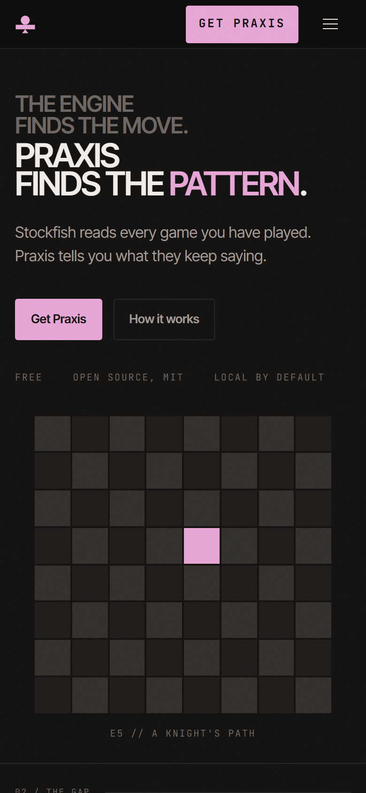

### Menu

Full-screen overlay: seven large display-type links with small monospace index numbers on the right, then a full-width "Get Praxis" button and a "View source" button.

| Link | Goes to |
|---|---|
| Index 01 | Hero |
| The gap 02 | The problem |
| Process 04 | How it works |
| The report 05 | The report |
| Evidence 06 | Evidence |
| Research 09 | Research |
| Get it 10 | Get it |

The numbers skip 03, 07 and 08 because three sections are not in the menu. **There is no close control once it is open** (Q4).

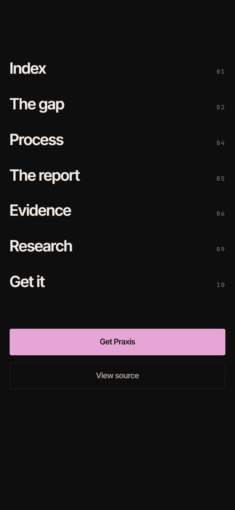

### What desktop has that mobile does not

The desktop build has a section rail on the right, a bottom status strip, corner registration marks and a scroll hint. All four are removed on mobile.

---

## 6. Component inventory

| Component | Where | Notes |
|---|---|---|
| **Section label** ("02 / THE GAP" + hairline to the right) | 7 of 11 sections | 9px mono, tertiary. Wraps to two lines when long (How it works). |
| **Display headline** | Every section | Uppercase Inter Tight, one phrase in orchid. Two sizes. |
| **Body / note** | Most sections | Secondary grey, sentence case. Most paragraphs were shortened for mobile. |
| **Micro claims** | Hero, Evidence, Local | 10px mono uppercase, tertiary, separated by `//` or spacing. |
| **Engine readout line** | The problem | Mono: move, evaluation swing, severity in red, clock. |
| **Metric** (big mono value + 9px label) | The problem, How it works, Research | Laid out 2×2, except Research which ends up 1 + 2 because its first label is long. |
| **Numbered list** (orchid index + title) | How it works | Six stage names. Desktop adds a one-line description per stage. |
| **Spec table rows** (key, value, status) | Evidence, Local | Mono key, sans value, mono status on the right; hairline between rows. |
| **Link rows** (index, title, action →) | Research, Get it | 56px tall, full width, hairlines between. The page's main way out to GitHub and Hugging Face. |
| **Buttons** | Header, hero, menu, end | Solid orchid (primary) and outlined (secondary). In-page buttons are 44px tall, sentence case; the header button is mono uppercase. |
| **Capture card** | Practice | Screenshot plus label in a hairline box with a 3.5% fill, 4px corners. |
| **Report capture** | The report | Screenshot cropped to a 2:1 strip, no box. |
| **Hero board** | Hero | 320×320, 64 squares, animated. |

---

## 7. Section by section

Measurements are at 390×844. "Cut on mobile" lists content that exists on desktop but is hidden on phones, so you know it is available if you want any of it back.

### 7.1 Hero (812px)

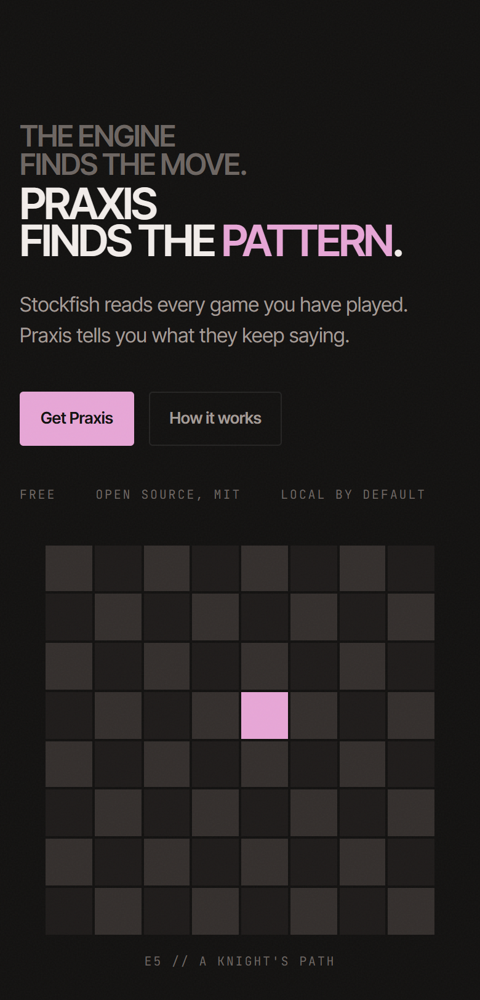

- Setup line, dim: **"THE ENGINE FINDS THE MOVE."**
- Headline: **"PRAXIS FINDS THE PATTERN."** ("PATTERN" in orchid)
- Body: *"Stockfish reads every game you have played. Praxis tells you what they keep saying."*
- Buttons: **Get Praxis** (solid, to the Get it section) and **How it works** (outlined, to How it works).
- Claims: FREE · OPEN SOURCE, MIT · LOCAL BY DEFAULT
- The animated board, 320×320, centred, with the caption "E5 // A KNIGHT'S PATH".
- The whole hero is almost exactly one screen at 390×844, with the board's caption sitting on the fold. At 360×780 and 430×932 the fold falls differently:

| 360×780 | 390×844 | 430×932 |
|---|---|---|
| 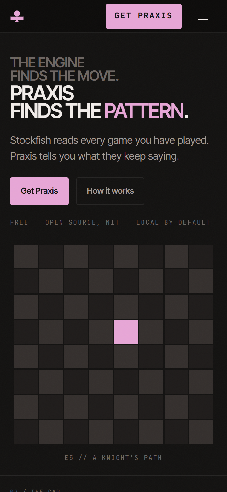 |  | 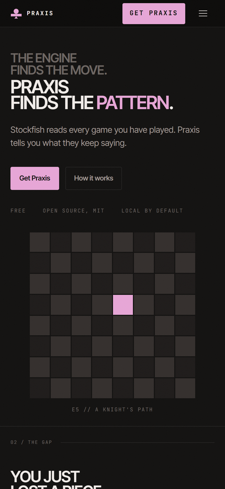 |

**Cut on mobile:** a small eyebrow line above the headline; the long version of the body copy.

### 7.2 The problem (574px)

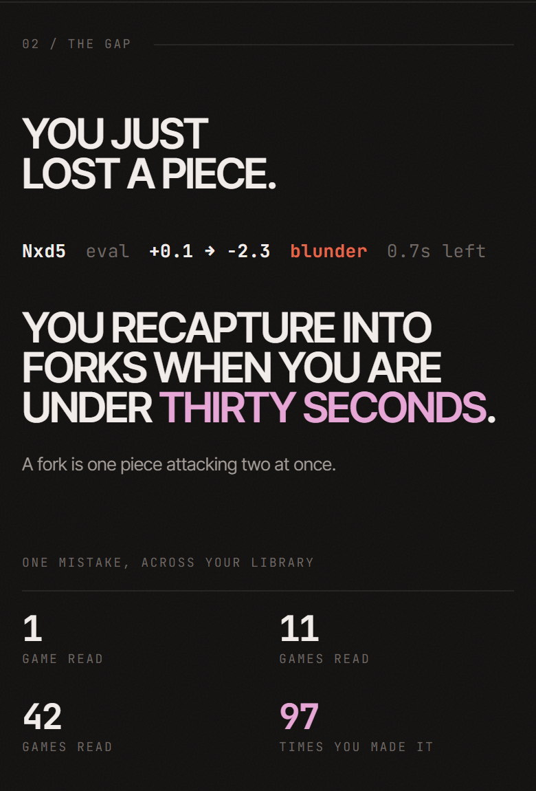

- Label: 02 / THE GAP
- Headline: **"YOU JUST LOST A PIECE."**
- Engine readout: `Nxd5  eval +0.1 → −2.3  blunder  0.7s left`
- Headline: **"YOU RECAPTURE INTO FORKS WHEN YOU ARE UNDER THIRTY SECONDS."** ("THIRTY SECONDS" in orchid)
- Note: *"A fork is one piece attacking two at once."* (kept deliberately for beginners)
- Micro heading over a hairline: ONE MISTAKE, ACROSS YOUR LIBRARY
- Metrics, 2×2: **1** game read · **11** games read · **42** games read · **97** times you made it (97 in orchid)

The intended reading: one blunder, then the habit behind it, then the count rising as more of your games are read.

**Cut on mobile:** an 18-row grid of the same mistake recurring across games (on desktop it accumulates as you scroll); a slate line ("Game 412 // blitz 5+0 // move 5"); a longer explanatory note.

### 7.3 The difference (173px)

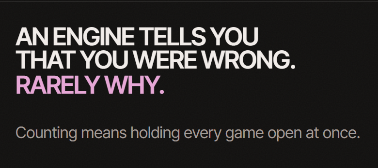

- Headline: **"AN ENGINE TELLS YOU THAT YOU WERE WRONG."** / **"RARELY WHY."** (orchid)
- Body: *"Counting means holding every game open at once."*

No section label. The shortest section on the page.

**Cut on mobile:** a dim column of standard engine output that sits beside the headline on desktop (the comparison only works side by side); a screenshot; a longer paragraph.

### 7.4 How it works (504px)

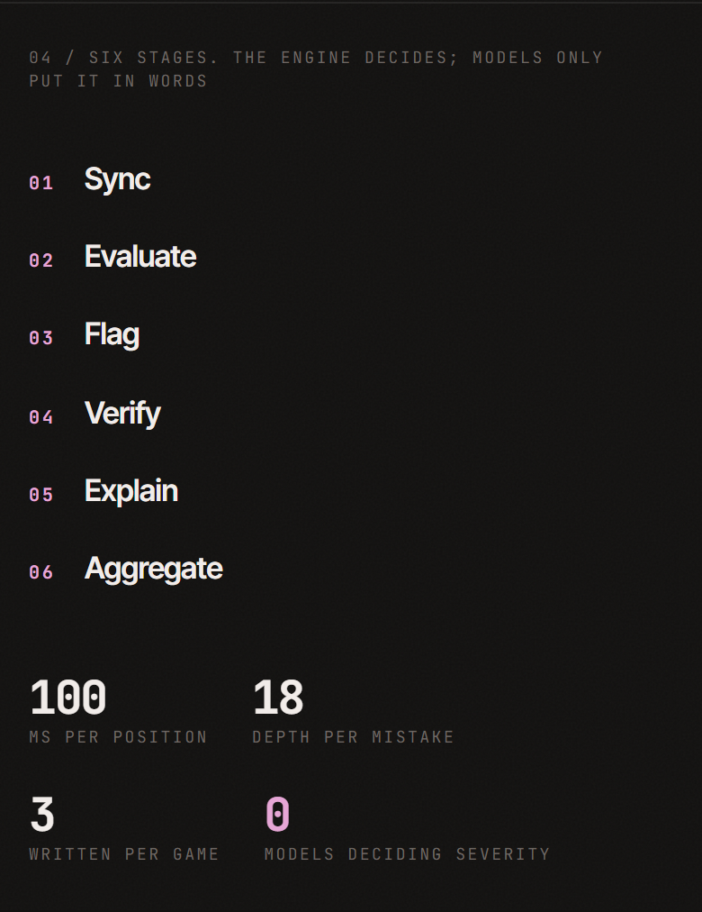

- Label (wraps to two lines): 04 / SIX STAGES. THE ENGINE DECIDES; MODELS ONLY PUT IT IN WORDS
- Six stages: 01 Sync · 02 Evaluate · 03 Flag · 04 Verify · 05 Explain · 06 Aggregate
- Metrics, 2×2: **100** ms per position · **18** depth per mistake · **3** written per game · **0** models deciding severity (0 in orchid)

**Cut on mobile:** a one-line description under each stage; a 22-row scrolling engine feed that visibly thins out on desktop.

### 7.5 The report (458px)

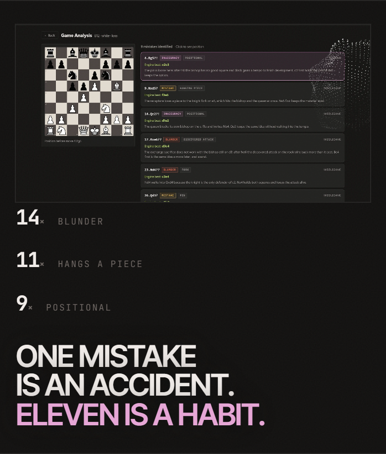

- A screenshot of the app's Game Analysis screen, cropped to a 2:1 strip (358×179): board on the left, mistake cards with severity badges on the right.
- Three counts: **14×** BLUNDER · **11×** HANGS A PIECE · **9×** POSITIONAL
- Headline: **"ONE MISTAKE IS AN ACCIDENT."** / **"ELEVEN IS A HABIT."** (orchid)

No section label.

**Cut on mobile:** a second, overlapping screenshot (Ask Prax, the app's question-answering screen); a methodology note.

### 7.6 Evidence (487px)

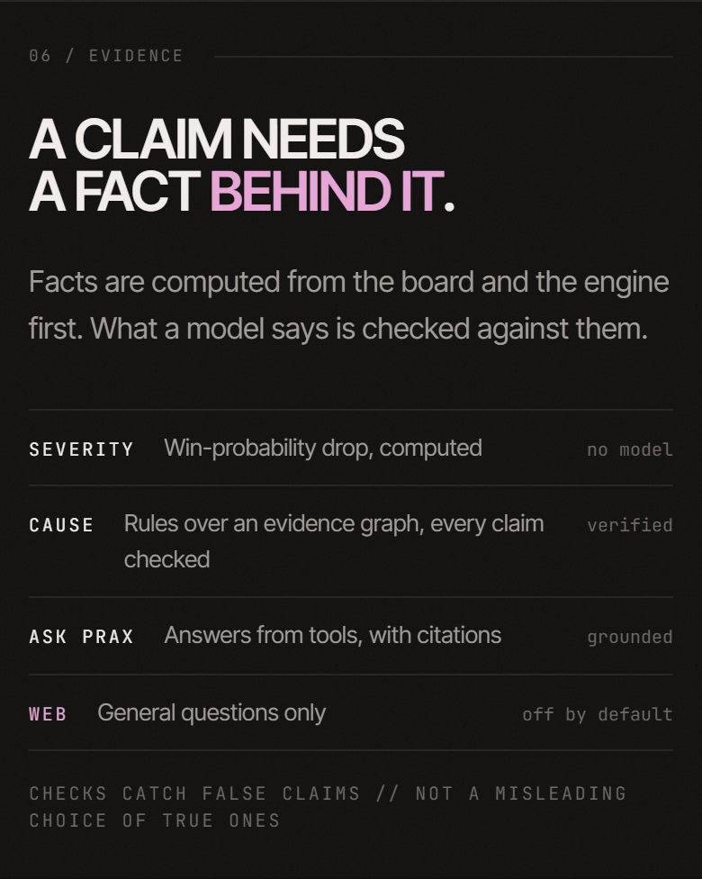

- Label: 06 / EVIDENCE
- Headline: **"A CLAIM NEEDS A FACT BEHIND IT."** ("BEHIND IT" in orchid)
- Body: *"Facts are computed from the board and the engine first. What a model says is checked against them."*
- Spec table:

| Key | Value | Status |
|---|---|---|
| SEVERITY | Win-probability drop, computed | no model |
| CAUSE | Rules over an evidence graph, every claim checked | verified |
| ASK PRAX | Answers from tools, with citations | grounded |
| WEB (orchid) | General questions only | off by default |

- Footnote: CHECKS CATCH FALSE CLAIMS // NOT A MISLEADING CHOICE OF TRUE ONES

**Cut on mobile:** a longer version of the body.

### 7.7 Practice (548px)

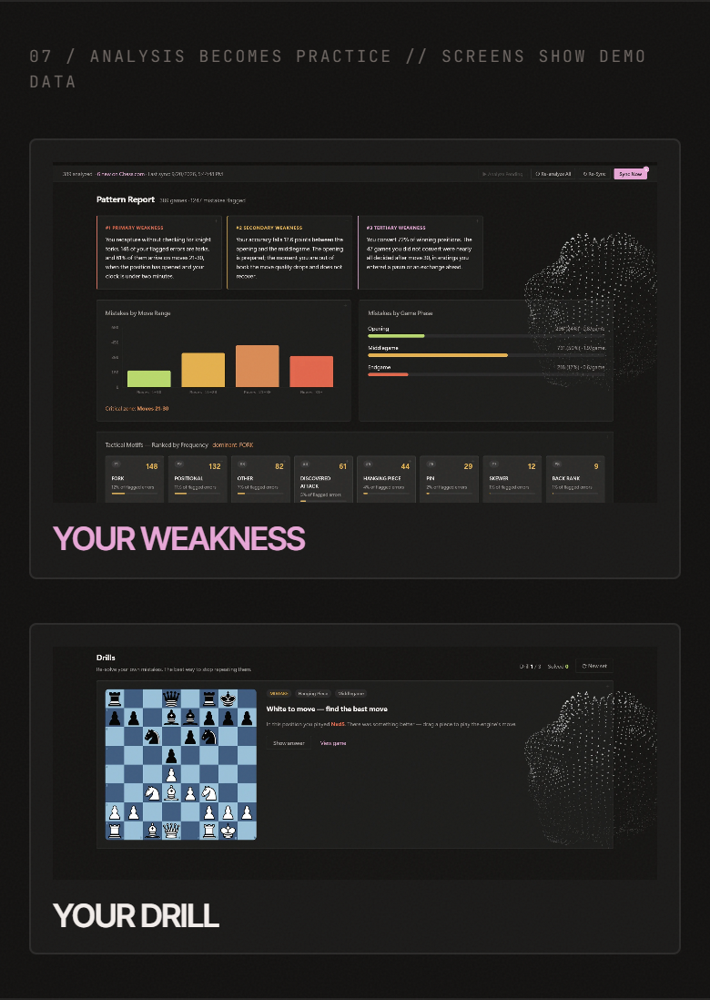

- Label: 07 / ANALYSIS BECOMES PRACTICE // SCREENS SHOW DEMO DATA
- Card 1: the Pattern Report screen (16:9) with the label **YOUR WEAKNESS** (orchid)
- Card 2: the Drills screen (cropped 2.6:1 to the board and prompt) with the label **YOUR DRILL**

The cards were added at the owner's request so each screenshot clearly belongs to its label.

**Cut on mobile:** three more screens (Today, Play & Improve, Insights) with their labels "Your games", "Your next game", "Your improvement". On desktop the five overlap in a layered composition with depth of field.

### 7.8 Local (496px)

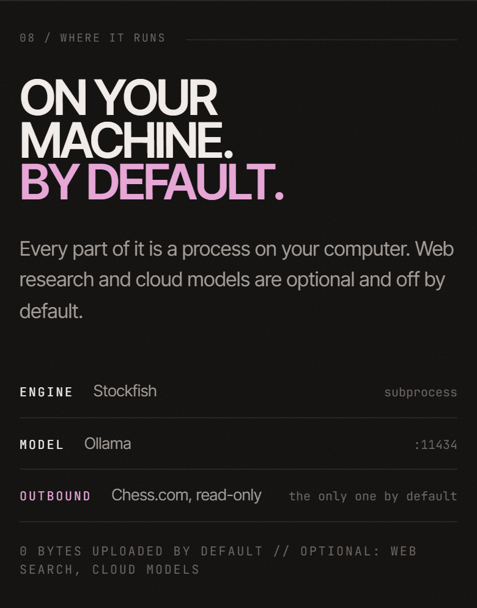

- Label: 08 / WHERE IT RUNS
- Headline: **"ON YOUR MACHINE. BY DEFAULT."**
- Body: *"Every part of it is a process on your computer. Web research and cloud models are optional and off by default."*
- Spec table: MOVE CHECKER · Stockfish finds your mistakes · on your computer / EXPLANATIONS · A local AI explains them in plain words · on your computer / INTERNET · Only to download your Chess.com games · nothing uploaded
- Footnote: 0 BYTES UPLOADED BY DEFAULT // OPTIONAL: WEB SEARCH, CLOUD MODELS

**Cut on mobile:** three implementation rows (backend, database, interface) and the long descriptions in the remaining rows.

### 7.9 Research (578px)

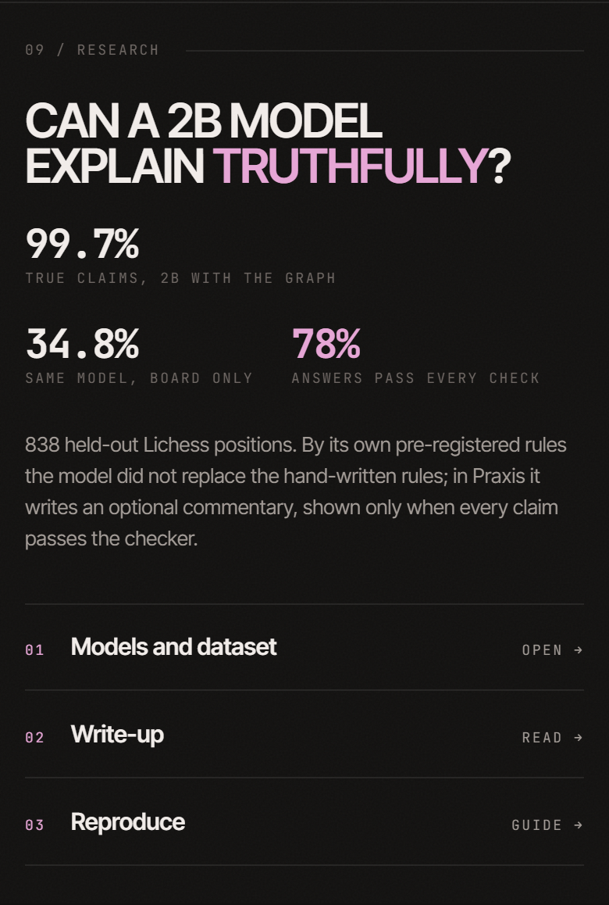

- Label: 09 / RESEARCH
- Headline: **"CAN A 2B MODEL EXPLAIN TRUTHFULLY?"** ("TRUTHFULLY" in orchid)
- Metrics: **99.7%** true claims, 2B with the graph · **34.8%** same model, board only · **78%** answers pass every check (orchid). They lay out 1 then 2.
- Body (four lines): *"838 held-out Lichess positions. By its own pre-registered rules the model did not replace the hand-written rules; in Praxis it writes an optional commentary, shown only when every claim passes the checker."*
- Link rows: 01 Models and dataset → OPEN · 02 Write-up → READ · 03 Reproduce → GUIDE

### 7.10 Get it (401px)

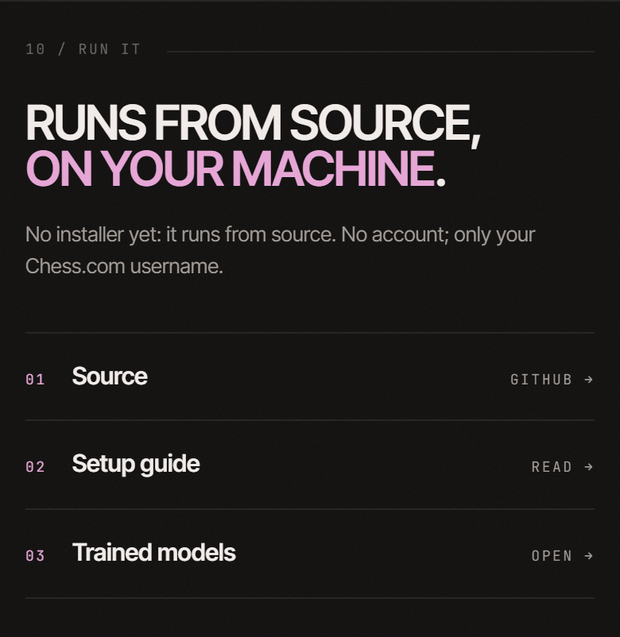

- Label: 10 / RUN IT
- Headline: **"RUNS FROM SOURCE, ON YOUR MACHINE."** (second line in orchid)
- Note: *"No installer yet: it runs from source. No account; only your Chess.com username."*
- Link rows: 01 Source → GITHUB · 02 Setup guide → READ · 03 Trained models → OPEN

**Cut on mobile:** a small meta line under each row (for example "GitHub · MIT licence").

### 7.11 End (481px)

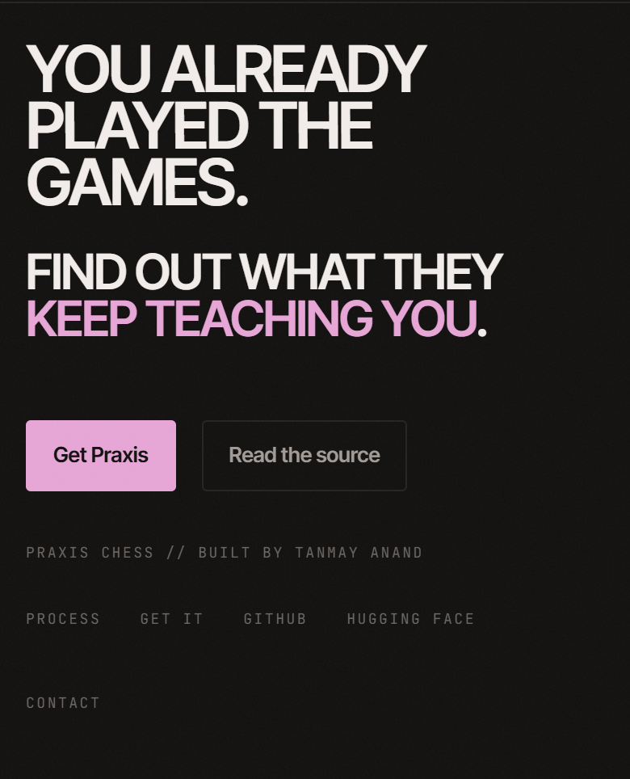

- Headline: **"YOU ALREADY PLAYED THE GAMES."**
- Line: **"FIND OUT WHAT THEY KEEP TEACHING YOU."** ("KEEP TEACHING YOU" in orchid)
- Buttons: **Get Praxis** (solid; this one goes to the GitHub setup instructions, not to the Get it section) and **Read the source** (outlined).
- Footer: PRAXIS CHESS // BUILT BY TANMAY ANAND, then Process · Download · GitHub · Contact.

---

## 8. Measurements

### Page

| Device | Page height | Screens |
|---|---|---|
| 360×780 | 5,202px | 6.67 |
| **390×844** | **5,512px** | **6.53** |
| 375×667 (iPhone SE/8) | 4,951px | 7.42 |
| 430×932 | 5,461px | 5.86 |

- **Visible words:** 452 at 390×844.
- **Screenshots shown:** 3 (Report, Pattern Report, Drills).
- **Horizontal overflow:** none.
- **Tap targets:** 19 interactive elements. Everything is at least 44px tall except the header button (40px), the logo link (20px) and the skip link (35px, only visible on keyboard focus).
- **Page weight:** about 404 KB and 23 requests on first load; about 601 KB and 25 requests after scrolling to the end (images 322 KB, CSS 101 KB, fonts 74 KB, JavaScript 49 KB, HTML 54 KB). Screenshots load lazily, and screenshots hidden on mobile are never downloaded.

### How the mobile page got here

| Stage | Height at 375–390px | Words | Screenshots |
|---|---|---|---|
| First mobile version (desktop content, stacked) | 7,242px | 690 | 9 |
| After two condensation passes | 3,723px | about 290 | 3 |
| **Now**, after the Evidence and Research sections were added | **5,512px** | **452** | 3 |

---

## 9. Decisions already made

These were deliberate choices by the owner during development. Please do not reverse them without a strong reason, and say so explicitly if you think one should be.

1. **Black and orchid identity, using the app's own tokens.** The site should look like the product.
2. **Orchid is a signal, never ambience.** One emphasised phrase per headline, the primary action, the marked square. Ambient pink glows and a decorative particle "organism" were both tried and removed.
3. **Real app screenshots only; never mocked-up UI.** The screenshots come from the real interface running on a demo game library, which the Practice label discloses ("screens show demo data").
4. **Plain English first, chess notation second.** "You just lost a piece." leads; "Nxd5" supports it. Short glosses for terms like "fork".
5. **No marketing clichés** ("revolutionary", "cutting-edge", "seamless", "AI-powered" and so on) and **no em dashes** in site copy.
6. **Sharp corners and hairlines**, no shadows, no gradients.
7. **Mobile changes must not alter desktop.**
8. **Mobile should be short and light on text.** The owner has asked for this twice.
9. **The Practice screenshots are shown as separate boxed cards.**

---

## 10. Known issues and open questions

Roughly in order of how much they matter. Each one is something I measured or observed, not a guess, and most come with options rather than a decided answer.

### Q1. What should a phone visitor actually do? (strategic)

The product is a desktop application that runs from source. Nobody can use it from their phone. Yet the mobile page offers **"Get Praxis" four times** (header, hero, menu, end), and three of them lead to a section whose first sentence is *"No installer yet: it runs from source."* The fourth goes straight to GitHub setup instructions, which are not usable on a phone either.

A mobile visitor's realistic next steps are more like: understand the idea; decide it is worth trying later; save it, share it or send it to their computer; star the repository; read the research. **What should the primary mobile action be, and what should the button say?** This probably reshapes the hero, the header and the end.

### Q2. The hero's headline is the smallest headline on the page

At 390px, *"Praxis finds the pattern."* is set at **35.2px**, while ordinary section headlines are **40px** ("On your machine.") and **30.4px** ("You just lost a piece."). The setup line *"The engine finds the move."* is 24px. The page's most important sentence is visually outranked by later ones. Cause: a sizing rule written for desktop wins over the mobile rule. Easy to fix; the question is what the hierarchy should be.

### Q3. The hero board

- It is **320×320** and fills roughly the lower half of the first screen.
- Its meaning ("one square, again and again, becoming a shape", which is what Praxis does with mistakes) only emerges after watching several 2.4-second steps. A visitor who scrolls straight past sees an almost blank dark grid with one pink square.
- The squares are **1.30:1** against each other and the board is **1.10:1** against the page: intentionally faint, but on a phone in daylight it may read as nothing.
- The caption "E5 // A KNIGHT'S PATH" is chess jargon.

Is the board the right hero visual on a phone? Should it be smaller, explained, moved, or replaced?

### Q4. The menu cannot be closed by touch

Once open, the menu covers the header, including the menu button. There is no close control inside the menu, and tapping empty space does nothing. The only ways out are choosing a link or pressing Escape, and phones have no Escape key. The button's accessible label also stays "Open menu" while the menu is open. The menu's numbering skips (01, 02, 04, 05, 06, 09, 10) because three sections are not listed.

### Q5. Small, low-contrast labels

Section labels, metric labels, link affordances ("GITHUB →") and the footer are **9px** monospace; micro labels are 10px. Most of them use `--text-tertiary` at **3.35:1**, which fails WCAG AA for text this size (4.5:1 needed). Uppercase tracking helps texture but not legibility. These labels carry real information ("GAMES READ", "TIMES YOU MADE IT", "SCREENS SHOW DEMO DATA").

### Q6. Length

6.5 screens and 452 words at 390×844, up from 4.6 screens before the Evidence and Research sections were added. The owner wants it shorter. Candidates to consider:
- Merge **The difference** into **The problem** (both say "an engine flags one move; the real issue is the habit").
- Merge **Evidence** and **Research** (both are about trusting the explanations).
- Merge **Research** and **Get it** (both end in a list of external links, and two of those links go to the same Hugging Face page).
- Drop or shrink the stage list or its metrics in How it works.

### Q7. Screenshots are not legible at phone width

They are screenshots of a dense desktop interface shown 330 to 360px wide, so their text is unreadable. They currently work as texture ("this is real software") rather than as evidence. Options: purpose-made tight crops of one card each, fewer screenshots, or none at all on mobile.

### Q8. Every section has the same rhythm

Almost every section is: small label, uppercase headline, grey paragraph, then a list, table or metric grid; left-aligned, separated by a hairline. The page reads as one long uniform column. Long uppercase headlines with very tight leading (for example *"YOU RECAPTURE INTO FORKS WHEN YOU ARE UNDER THIRTY SECONDS."*, four lines) are also harder to read on a phone than sentence case would be.

### Q9. The Research section is dense

A four-line paragraph of research vocabulary ("held-out", "pre-registered", "2B", "the graph"), metrics laid out 1 then 2 (inconsistent with the 2×2 grids elsewhere), and three external links. It is the wordiest section on the page (72 words).

### Q10. Naming and destinations are inconsistent

The same destination is called "Get Praxis", "Get it", "Run it" and "Download" in different places. "Get Praxis" goes to the on-page Get it section from the header, hero and menu, but to GitHub's setup instructions from the end of the page.

### Q11. Section labelling is inconsistent

Seven sections print a numbered label; four do not (Hero, The difference, The report, End). A reader therefore sees 02, 04, 06, 07, 08, 09, 10. The numbers mean something on desktop, where a side rail lists every section; on mobile they look like gaps.

### Q12. No motion except the hero board

A scroll-in reveal is built but unused on mobile. Should sections animate in? The owner's direction has generally been "less, but deliberate", and performance matters.

### Q13. Spacing changes on short phones by accident

Height-based rules written for the desktop build also shrink the spacing tokens on phones under 820px tall (section padding 24px becomes 20px, then 16px on a 375×667 phone). It may be fine, but it was not designed.

### Q14. Type does not scale smoothly across phone widths

Because 390px phones fall in the small-phone tier, a 430px phone gets a slightly **smaller** section headline (29.7px) than a 390px phone (30.4px).

### Q15. Long section labels wrap

At 9px, *"04 / SIX STAGES. THE ENGINE DECIDES; MODELS ONLY PUT IT IN WORDS"* wraps to two lines, and so does the Practice label. Labels were designed as one-line tags.

---

## 11. Implementation notes

For whoever builds the recommendations. You do not need any of this to review the design.

- **Where mobile styling lives:** `css/mobile.css`, inside `@media (max-width:760px)` (the phone build) and `@media (max-width:400px)` (small phones). Rules there cannot reach desktop. `css/base.css` holds the shared tokens; `css/site.css` is the desktop build and should not be edited for mobile work (except, if Q13 is acted on, scoping its height-based rules).
- **Mobile-only content:** two mechanisms in `index.html`.
  - `class="m-cut"` hides an element on phones only.
  - `class="m-only"` together with the `hidden` attribute shows an element on phones only. This is how the mobile page has its own shorter wording.
- **Preview locally:** run `python serve.py` in the project folder and open <http://localhost:5500>, using the browser's device emulation. Reload after crossing 760px, since the two builds load differently.
- **Checks:** `python tools/check.py` validates links, sections and assets.
- **Screenshots of the app:** produced by `tools/capture.js` against the real interface; see `assets/app/README.md`.

---

## 12. Screenshot index

All at 2× resolution unless noted.

| File | What |
|---|---|
| [`00-first-screen-360.png`](img/00-first-screen-360.png) | First screen, 360×780 |
| [`00-first-screen-390.png`](img/00-first-screen-390.png) | First screen, 390×844 |
| [`00-first-screen-430.png`](img/00-first-screen-430.png) | First screen, 430×932 |
| [`01-full-page-390.png`](img/01-full-page-390.png) | The whole page at 390px wide (1×) |
| [`02-menu-open-390.png`](img/02-menu-open-390.png) | Menu open |
| [`sec-01-hero.png`](img/sec-01-hero.png) | Hero |
| [`sec-02-problem.png`](img/sec-02-problem.png) | The problem |
| [`sec-03-difference.png`](img/sec-03-difference.png) | The difference |
| [`sec-04-pipeline.png`](img/sec-04-pipeline.png) | How it works |
| [`sec-05-report.png`](img/sec-05-report.png) | The report |
| [`sec-06-evidence.png`](img/sec-06-evidence.png) | Evidence |
| [`sec-07-practice.png`](img/sec-07-practice.png) | Practice |
| [`sec-08-local.png`](img/sec-08-local.png) | Local |
| [`sec-09-research.png`](img/sec-09-research.png) | Research |
| [`sec-10-download.png`](img/sec-10-download.png) | Get it |
| [`sec-11-end.png`](img/sec-11-end.png) | End |

Section screenshots were taken with the fixed header hidden, so it does not cover the top of each section. Scroll-in states were captured in their finished state. The hero board is caught mid-animation.
